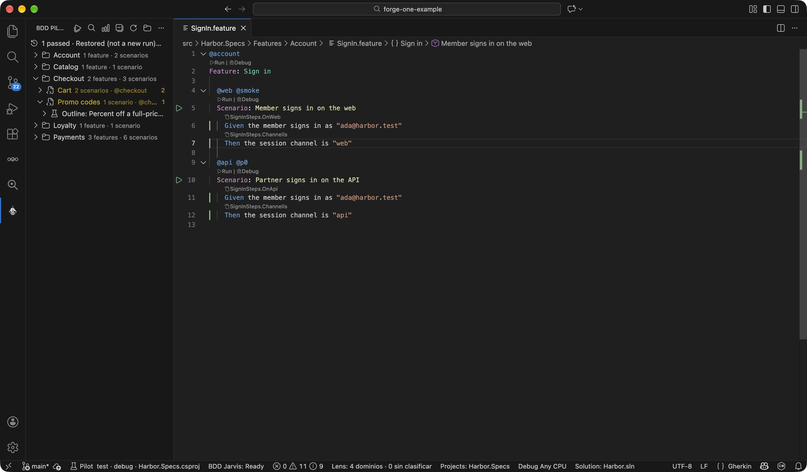
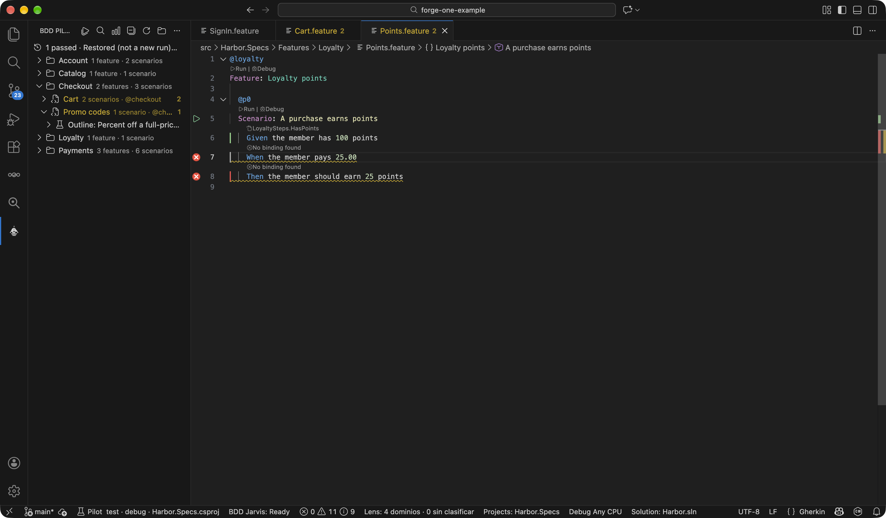

# BDD Guardian

**Know where every Gherkin step is implemented — and which ones aren't.**

Go to Definition, CodeLens, and live diagnostics for `.feature` files in VS Code. Works with Reqnroll, SpecFlow, Cucumber.js, Cucumber-JVM, Godog, and Behave.

[](https://marketplace.visualstudio.com/items?itemName=anghelll.bdd-guardian)
[](https://marketplace.visualstudio.com/items?itemName=anghelll.bdd-guardian)
[](https://marketplace.visualstudio.com/items?itemName=anghelll.bdd-guardian&ssr=false#review-details)
[](https://github.com/AngHelll/bdd-guardian/actions)
[](LICENSE)

In a growing BDD suite, steps drift away from their bindings: a typo leaves a step unbound, two regexes start matching the same line, old bindings stop being used. You usually find out when the test run fails. Guardian shows it while you type.



## Why Guardian

- **Jump from step to code and back.** `F12` on a step opens its binding; CodeLens on a binding lists every step that uses it.
- **Catch unbound and ambiguous steps before running anything.** Problems panel, gutter, and CodeLens use the same resolver, aligned with how Reqnroll reports ambiguity.
- **See the holes in the whole suite.** The **BDD Map** view lists unbound steps, ambiguous steps, and unused bindings across the workspace.
- **Fix in place.** Copy a binding snippet or generate the scaffold in your step-definition file, for six frameworks.
- **One index, many stacks.** C#, JavaScript/TypeScript, Java, Go, and Python bindings in the same workspace.
- **No glue configuration.** No step globs or paths to set up; Guardian finds the bindings on its own.

## Quick start

1. Install **BDD Guardian** from the Extensions view, or run `ext install anghelll.bdd-guardian`.
2. Open a folder that has `.feature` files and step definitions.
3. Wait for **Ready** in the status bar. CodeLens appears above each step: bound, unbound, or ambiguous.
4. Press `F12` on a step to open its binding, or `Shift+F12` on a binding to find its usages.

No project yet? Open [`samples/binding-demo/`](./samples/binding-demo/) from this repo.

## Supported frameworks

| Stack | Bindings |
|-------|----------|
| C# — **Reqnroll** and **SpecFlow** | `[Binding]`, `[Given(@"...")]`, verbatim patterns with quotes |
| JavaScript / TypeScript — **Cucumber.js** | `Given('...')`, Cucumber Expressions |
| Java — **Cucumber-JVM** | `@Given("...")` |
| Go — **Godog** | `ctx.Step(...)` |
| Python — **Behave** | `@given('...')` |
| Python — **pytest-bdd** | `@given('...')` from `pytest_bdd`, including `{count:d}` |

Frameworks are detected automatically. **Show Provider Detection Report** explains what was found.

Samples for each stack live in [`samples/`](./samples/).

## Features

### CodeLens on steps and bindings

- Above each step: **✓ `Class.Method`** (click to open), **✗ unbound**, or **⚠ ambiguous** (click to pick).
- Above each binding: **→ N usages (M scenarios)**, or **No usages** when nothing resolves to it.

### Go to Definition and Find All References

| From | `F12` / `Shift+F12` shows |
|------|---------------------------|
| A step in a `.feature` | Its binding, and other steps that resolve to the same binding |
| A binding in `.cs`, `.ts`, `.py`, `.go`, `.java` | The binding and every step that uses it |

`Alt+←` / `Alt+→` move back and forward between steps and bindings; `Alt+H` opens the history.

### Diagnostics while you type

The Problems panel flags **unbound** and **ambiguous** steps as you edit, plus **unused bindings** as Information. Scenario Outlines are expanded with their Examples values, so parameterized steps resolve correctly.



### BDD Map

An Explorer view with every hole in the step ↔ binding map, grouped by `.feature`. Each row offers **Explain** (why it's unbound or which bindings collide) and **Generate binding**. Run **BDD Guardian: Show suite map**.

### Hover with context

- **Bound:** binding class and method, pattern, captured parameters, code preview.
- **Unbound:** why (empty index, scoped-out tag, or no match), a similar existing step when there's a clear candidate, and a suggested pattern.
- **Ambiguous:** the top matches, with the best one highlighted.

### Author actions

On an unbound step, the lightbulb offers **Copy binding snippet**, **Copy suggested pattern**, or **Generate binding**. Generate inserts into an existing step-definition file or creates a conventional one (`StepDefinitions/GuardianGeneratedSteps.cs`, `features/step_definitions/guardian-generated.steps.ts`, `features/steps/guardian_generated_steps.py`, and so on).

### Step autocomplete

While typing `Given` / `When` / `Then`, IntelliSense suggests steps that already have a binding. It never invents steps.

### BDD Coach (opt-in)

Writing-quality hints for `.feature` files: duplicate steps, Given/When/Then order, vague or too many `Then`s, redundant tags, long steps, UI details leaking into scenarios. Includes a health score in the status bar. Turn it on with `bddGuardian.coach.enabled`.

## Works well with

Guardian is one piece of the **ForgeOne** BDD family. Each extension does one job, so they don't fight over your `.feature` files.

| Extension | Job |
|-----------|-----|
| **BDD Guardian** (this one) | What a step **means**: bindings, navigation, diagnostics |
| [BDD Gherkin Format](https://marketplace.visualstudio.com/items?itemName=anghelll.bdd-gherkin-format) | How a `.feature` **looks**: Format Document, table alignment, syntax colors |
| [BDD Pilot](https://marketplace.visualstudio.com/items?itemName=anghelll.bdd-pilot) | **Runs** Reqnroll / SpecFlow scenarios with `dotnet test` and maps the results |

Want Format and Guardian in one install? Get the [**BDD ForgeOne**](https://marketplace.visualstudio.com/items?itemName=anghelll.bdd-forgeone) extension pack.

Guardian doesn't run tests. For Reqnroll / SpecFlow, [BDD Pilot](https://marketplace.visualstudio.com/items?itemName=anghelll.bdd-pilot) does.

## Coming from Cucumber or Cucumber Full Support

| If you're used to… | With Guardian |
|--------------------|---------------|
| Setting `cucumber.glue` or step globs per project | Nothing to set. Frameworks are detected, and every folder of a multi-root workspace is searched |
| Go to Definition landing on the wrong step when two patterns overlap | Both matches are reported as **ambiguous**, with an **Explain** that names the colliding bindings |
| Not knowing where a step definition is used | CodeLens **N usages** on every binding, `Shift+F12`, and **unused bindings** in Problems and the BDD Map |
| An undefined-step warning you can't turn off | `reqnrollNavigator.enableDiagnostics`, `bddGuardian.ui.feedbackLevel`, and `reqnrollNavigator.tagFilter` |
| Writing the step definition by hand | **Generate binding** for all six frameworks |

Uninstall the other extension rather than running both: each bundles its own step resolver, and two resolvers can disagree. Use Gherkin Format for layout and colors instead:

```json
"[gherkin]": {
  "editor.defaultFormatter": "anghelll.bdd-gherkin-format",
  "editor.formatOnSave": true
}
```

## Configuration

Most teams need no configuration. Settings you're most likely to touch:

| Setting | Default | What it does |
|---------|---------|--------------|
| `bddGuardian.displayLanguage` | `en` | UI language: `en` or `es` |
| `bddGuardian.ui.feedbackLevel` | `standard` | Visual density: `full`, `standard`, or `minimal` |
| `bddGuardian.gutterIcons.showBound` | `false` | Also show a green check on bound steps |
| `bddGuardian.coach.enabled` | `false` | Turn on BDD Coach |
| `bddGuardian.matching.preferSpecificBinding` | `false` | On multiple matches, pick the highest score instead of reporting ambiguous |
| `bddGuardian.providers.indexMode` | `all` | `all` indexes every detected framework; `primary` only the most confident one |
| `reqnrollNavigator.bindingsGlob` | `**/*.cs` | Where to look for bindings |
| `reqnrollNavigator.excludePatterns` | `bin`, `obj`, `node_modules` | Paths to skip |

<details>
<summary>All settings</summary>

Keys under `reqnrollNavigator.*` are legacy IDs kept for backward compatibility.

| Setting | Default | What it does |
|---------|---------|--------------|
| `bddGuardian.gutterIcons.enabled` | `true` | Gutter icons on unbound / ambiguous steps |
| `bddGuardian.hoverDetails.enabled` | `true` | Rich hover with code preview |
| `bddGuardian.ui.showMatchScore` | `false` | Show the match score in CodeLens (debug) |
| `bddGuardian.onboarding.enabled` | `true` | One-time hint when features exist but no bindings are indexed |
| `bddGuardian.authorActions.enabled` | `true` | Copy / generate quick fixes on unbound steps |
| `bddGuardian.autocomplete.enabled` | `true` | Step suggestions from indexed bindings |
| `bddGuardian.orphanBindings.enabled` | `true` | Information diagnostics on unused bindings (skipped above 2,000 bindings) |
| `bddGuardian.suiteMap.enabled` | `true` | Show the BDD Map view |
| `bddGuardian.pilotHandoff.enabled` | `true` | Offer Open / Install BDD Pilot and Run with Pilot |
| `bddGuardian.formatHint.enabled` | `true` | Suggest BDD Gherkin Format for `.feature` layout |
| `bddGuardian.coach.statusBar.enabled` | `true` | Health score in the status bar when Coach is on |
| `bddGuardian.coach.stepLength.max` | `120` | Max step length before Coach warns |
| `bddGuardian.coach.dominantThen.max` | `1` | Max `Then` steps per scenario before Coach warns |
| `bddGuardian.coach.disabled` | `[]` | Coach rules to turn off |
| `bddGuardian.coach.severityOverrides` | `{}` | Per-rule severity |
| `reqnrollNavigator.enableCodeLens` | `true` | CodeLens above steps |
| `reqnrollNavigator.enableDiagnostics` | `true` | Problems for unbound / ambiguous steps |
| `reqnrollNavigator.enableDecorations` | `true` | Status border and overview ruler marks |
| `reqnrollNavigator.caseInsensitive` | `false` | Case-insensitive matching |
| `reqnrollNavigator.tagFilter` | `[]` | Only check steps with (or without) these tags |
| `reqnrollNavigator.tagFilterMode` | `include` | `include` or `exclude` for `tagFilter` |
| `reqnrollNavigator.featureGlob` | `**/*.feature` | Where to look for features |
| `reqnrollNavigator.maxFilesIndexed` | `5000` | Upper bound on indexed files |
| `reqnrollNavigator.navigationHistorySize` | `50` | Back / forward history size |
| `reqnrollNavigator.debug` | `false` | Verbose output |

</details>

### Large repositories

Indexing runs in batches and never blocks the editor; the status bar shows **Indexing…** meanwhile. For monorepos, raise the file limit and exclude build output:

```json
{
  "reqnrollNavigator.maxFilesIndexed": 10000,
  "reqnrollNavigator.excludePatterns": ["**/bin/**", "**/obj/**", "**/node_modules/**", "**/TestResults/**"]
}
```

## Requirements

VS Code 1.85 or later, on Windows, macOS, or Linux. Works over Remote SSH, Dev Containers, and Codespaces.

## Known issues

- Very large projects take a moment to index the first time.
- Advanced regex in bindings (lookaheads, complex nested groups) may resolve differently than the test runner. Plain alternation `(a|b)` is covered. See [docs/BINDING_MATCHING.md](docs/BINDING_MATCHING.md).

## Learn more

- [What's new](CHANGELOG.md)
- [Visual language: icons and colors](docs/VISUAL_LANGUAGE.md)
- [How step matching works](docs/BINDING_MATCHING.md)
- [Adding a framework provider](docs/PROVIDERS.md)
- [Roadmap](ROADMAP.md)

Found a bug or want a framework supported? [Open an issue](https://github.com/AngHelll/bdd-guardian/issues). Contributions are welcome; see [CONTRIBUTING.md](CONTRIBUTING.md).

MIT License. Built for the Reqnroll, SpecFlow, and Cucumber communities.
